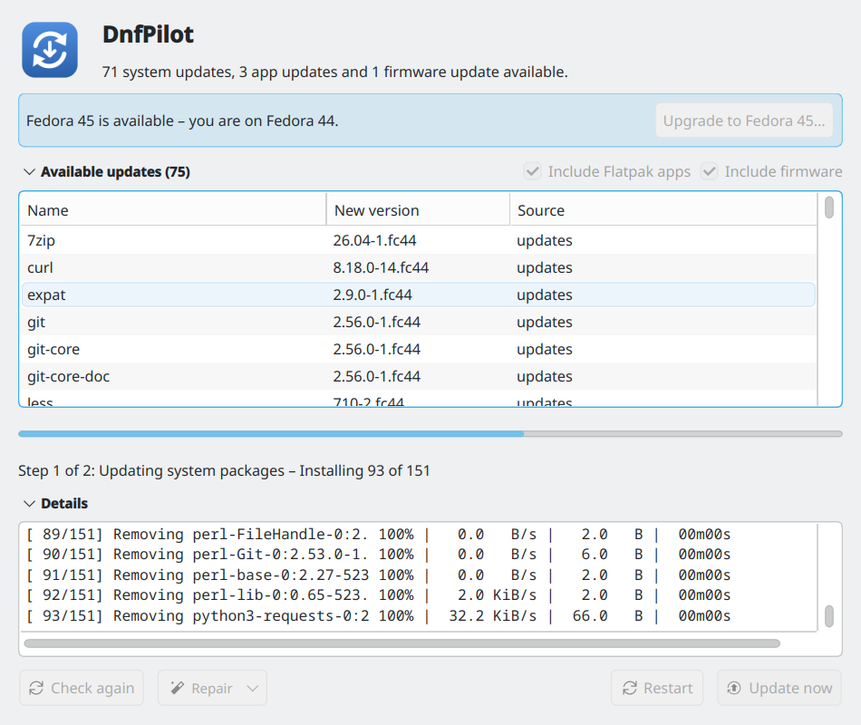

# DnfPilot

<p>
  
  <a href="https://github.com/TechnikWeber/DnfPilot/releases/latest"></a>
  <a href="https://github.com/TechnikWeber/DnfPilot/releases"></a>
  <a href="https://github.com/TechnikWeber/DnfPilot/actions/workflows/ci.yml"></a>
  
  
  <a href="LICENSE"></a>
</p>

<p>
  <a href="https://github.com/TechnikWeber/DnfPilot/releases/latest"><b>Download</b></a> &nbsp;·&nbsp;
  <a href="#download"><b>Install</b></a> &nbsp;·&nbsp;
  <a href="https://technikweber.github.io/2026/fedora-einrichten-und-aktuell-halten/"><b>Blog post (German)</b></a> &nbsp;·&nbsp;
  <a href="https://github.com/TechnikWeber/DnfSetup"><b>Set up a fresh install: DnfSetup</b></a> &nbsp;·&nbsp;
  <a href="https://github.com/TechnikWeber/DnfPilot/releases"><b>Releases</b></a>
</p>

Update Fedora with `dnf upgrade --refresh` and `flatpak update` from a small
window, with a progress bar, fold-out details and a restart button, instead of
Discover's offline update.



## Why

Discover on Fedora KDE installs system updates as an *offline update* during the
next restart. When packages go missing in between, it stops with
*"Cannot download files, cacheonly option is enabled"* and, without network at
that point, cannot recover. Updating while the system is running avoids that.

## What it does

* Lists the waiting dnf and Flatpak updates when it opens.
* **Update now** asks for your password once (polkit), then runs
  `dnf upgrade --refresh` and `flatpak update`. The bar follows dnf package by
  package; **Details** shows the full output.
* Firmware updates (fwupd) and, if installed, Snap updates are part of the
  same run.
* **New Fedora release?** A banner offers the upgrade (`dnf system-upgrade`:
  download while you work, install on restart). A dry run comes first and
  shows how many packages change, the download size and anything that would
  be removed. It reads Fedora's official
  release list, so it knows on release day – Discover depends on AppStream
  metadata that can lag behind (Fedora 45 stayed marked as "development" for
  over a week, [bug 2568647](https://bugzilla.redhat.com/show_bug.cgi?id=2568647)).
* Afterwards it tells you whether a restart is needed: kernel, glibc, systemd,
  Plasma, Mesa or a graphics driver updated since boot. **Restart** is always
  one click away – except while akmods is still building the NVIDIA module for
  a new kernel, because restarting then ends with a black screen.
* **Repair** menu for when things go wrong:
  * cancel an offline update Discover has scheduled, then update
  * reload package lists (`dnf clean all`), then update
  * resolve package conflicts (`--best --allowerasing`), showing first what
    would be removed
  * clear the Discover/PackageKit cache
  * update Flatpak apps only
  * update firmware only
  * download now, install during the next restart (`dnf offline`)

## Download

From the [latest release](https://github.com/TechnikWeber/DnfPilot/releases/latest):

| File | For |
|---|---|
| `dnfpilot-*-x86_64.AppImage` | Download, make executable, run. Or open it with [Gear Lever](https://flathub.org/apps/it.mijorus.gearlever), which also updates it. |
| `dnfpilot-*.noarch.rpm` | `sudo dnf install ./dnfpilot-*.noarch.rpm`. Uses the system Qt, so it looks native and is tiny. |
| `dnfpilot-terminal` | One bash file, no Python: a kdialog menu that runs the commands in Konsole (KDE only, English or German). |

Or from the source, for your user only:

```bash
git clone https://github.com/TechnikWeber/DnfPilot.git
cd DnfPilot
./install.sh      # menu entry + `dnfpilot` command; ./uninstall.sh removes them
```

It needs `python3-pyside6`, which `install.sh` offers to install.

For setting up a fresh install (RPM Fusion, codecs, drivers, Flathub), see
the sibling project [DnfSetup](https://github.com/TechnikWeber/DnfSetup).

## Good to know

* Only for Fedora (dnf5) and other systems with `dnf`. Flatpak, fwupd and Snap
  are optional.
* No Flatpak package: a sandboxed app cannot run `dnf` on the host.
* Closing the window during an update is blocked, because stopping dnf halfway
  can leave the system in a broken state.
* The AppImage brings its own Qt, so it uses Qt's default look instead of
  Breeze. The RPM and `install.sh` look native.
* Not affiliated with the Fedora Project.

## License

[MIT](LICENSE).
